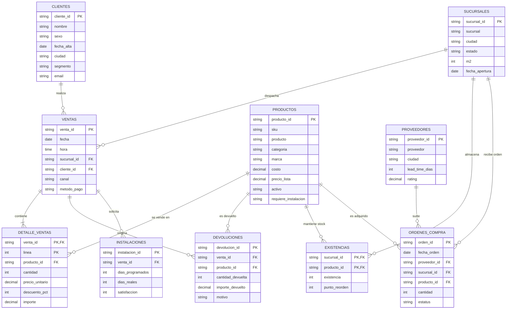
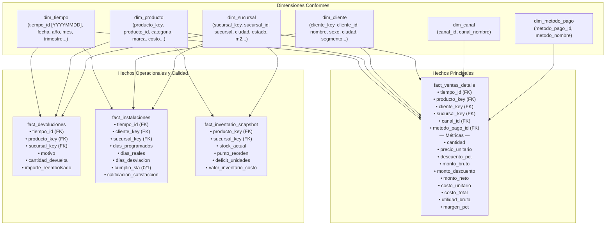

# Documento de Arquitectura de Datos y Modelado Dimensional
## Producto Integrador de Aprendizaje (PIA) — Solución BI Empresarial Completa
### Empresa: Casa&Estilo (Sector: Muebles y Decoración)

---

### Metadatos del Documento
- **Institución:** Universidad Autónoma de Nuevo León (UANL)
- **Facultad:** Facultad de Ingeniería Mecánica y Eléctrica (FIME)
- **Unidad de Aprendizaje:** Analítica e Inteligencia de Negocios
- **Equipo:** Equipo 8
- **Semestre:** Agosto - Diciembre 2026
- **Entorno Tecnológico:** MySQL 8.0, Docker Engine, Python 3.12, Excel 365 / Power Pivot, DAX
- **Función General:** Documentar integralmente la arquitectura de la solución de Business Intelligence para Casa&Estilo, formalizando el análisis de calidad de las fuentes RAW, el modelo relacional operacional, el diseño dimensional en esquema estrella, el diccionario de datos y las justificaciones teóricas y prácticas de diseño.
- **Función Específica:** Proporcionar la base conceptual y técnica para la implementación del Data Mart en MySQL 8.0, la orquestación del pipeline ETL y la alimentación del modelo analítico para el Dashboard Ejecutivo y la Presentación ante el Comité Directivo.

---

## 1. Contexto de Negocio y Entendimiento de la Empresa

### 1.1. Perfil Empresarial
**Casa&Estilo** es una cadena comercial omnicanal especializada en el diseño, comercialización y distribución de muebles para el hogar, oficinas y artículos de decoración de alta gama. Su red de distribución integra:
- **16 Sucursales Físicas:** Ubicadas estratégicamente en el noreste de México (Nuevo León, Coahuila y Tamaulipas), que concentran salas de exhibición de entre 1,000 y 1,800 $m^2$.
- **Canales Digitales Integrados:** Plataforma de comercio electrónico (Sitio Web) y Aplicación Móvil (App), que permiten compras a distancia y entregas a domicilio.
- **Servicios de Valor Agregado:** Servicio técnico de armado e instalación especializada para mobiliario de alta complejidad (recámaras, comedores y salas).

### 1.2. Problemática y Desafíos Estratégicos
La dirección general de Casa&Estilo enfrenta desafíos críticos de toma de decisiones debido a la dispersión de sus sistemas transaccionales:
1. **Falta de Visibilidad Omnicanal:** Desconexión entre los datos de ventas en piso de venta, comercio electrónico y app móvil, imposibilitando un análisis unificado de margen y ticket promedio.
2. **Costo de No Calidad e Impacto de Devoluciones:** Frecuentes devoluciones sin categorización analítica que erosionan el margen operativo bruto.
3. **Desviaciones en el SLA Logístico de Instalaciones:** Tiempos reales de instalación que superan las fechas comprometidas, afectando negativamente el índice de satisfacción del cliente.
4. **Desbalance en la Gestión de Inventarios:** Sucursales con quiebres de stock (rotura) en productos de alta rotación coexistiendo con capital inmovilizado en líneas de baja demanda.

---

## 2. Perfilado y Análisis de Calidad de Fuentes RAW

Se realizó una auditoría cuantitativa y cualitativa sobre los 11 archivos CSV del ecosistema transaccional entregado a Casa&Estilo, totalizando más de 530,000 registros:

| Archivo Fuente | Dominio | Registros | Clave Primaria (PK) | Calidad y Anomalías Detectadas | Tratamiento ETL Definido |
| :--- | :---: | :---: | :---: | :--- | :--- |
| `ERP/productos.csv` | ERP | 1,340 | `producto_id` | Presencia de UTF-8 BOM (`\ufeff`). 100% integridad en costos y precios. 349 productos requieren instalación. | Limpieza de BOM, cálculo de margen teórico y carga a `dim_producto`. |
| `ERP/proveedores.csv` | ERP | 160 | `proveedor_id` | Lead times entre 5 y 30 días; ratings entre 3.0 y 5.0. Sin nulos. | Estandarización de textos y carga a staging. |
| `CRM/clientes.csv` | CRM | 10,800 | `cliente_id` | 20 registros con `ciudad` vacía/nula; 43 con `email` nulo; 235 con `sexo` registrado como 'N/E'. | Imputación: ciudad='No Especificada', email='sin_correo@ejemplo.com', sexo='No Especificado'. |
| `OPERACION/sucursales.csv` | Operación | 16 | `sucursal_id` | Información completa de superficie ($m^2$) y fechas de apertura (2010 a 2024). | Categorización por formato de superficie (Pequeña, Mediana, Grande). |
| `MARKETING/promociones.csv` | Marketing | 180 | `promocion_id` | Campañas promocionales con descuentos del 5% al 30%. | Validación de fechas de vigencia contra transacciones. |
| `POS/ventas.csv` | POS | 140,000 | `venta_id` | Cabeceras de venta 2024-01-01 a 2026-09-30. Canales: Tienda (68%), Web (22%), App (10%). | Validación de integridad referencial hacia clientes y sucursales. |
| `POS/detalle_ventas.csv` | POS | 331,758 | `(venta_id, linea)` | **Hallazgo Crítico:** La columna `importe` en el RAW contiene el subtotal bruto (`cantidad * precio_unitario`), sin descontar el `descuento_pct`. | Desglose en staging de: `monto_bruto`, `monto_descuento` y `monto_neto = monto_bruto - monto_descuento`. |
| `POS/devoluciones.csv` | POS | 9,952 | `devolucion_id` | Reembolsos asociados a ventas. El `importe_devuelto` corresponde al valor unitario bruto devuelto. | Vinculación analítica con la línea de venta y marcado de flag de devolución. |
| `INVENTARIO/existencias.csv` | Inventario | 21,440 | `(sucursal_id, producto_id)` | Cobertura total de 16 sucursales $\times$ 1,340 productos. 126 registros con stock 0; puntos de reorden entre 5 y 39. | Cálculo de déficit de inventario y semáforo de abastecimiento. |
| `COMPRAS/ordenes_compra.csv` | Compras | 13,000 | `orden_id` | Estatus: Recibida (77.9%), Pendiente (10.4%), Parcial (7.8%), Cancelada (3.9%). | Evaluación de eficiencia de abasto por proveedor. |
| `ESPECIFICO/instalaciones.csv` | Operación | 6,500 | `instalacion_id` | Desviación sistemática entre `dias_programados` y `dias_reales`. Satisfacción calificada de 1 a 5. | Cálculo de varianza de días, indicador binario de cumplimiento SLA y correlación con satisfacción. |

---

## 3. Modelo Entidad-Relación (ER) Operacional

El ecosistema transaccional de origen responde a un modelo transaccional relacional (3NF) que interconecta la operación de tienda física, compras y CRM:

---

## 4. Diseño del Modelo Dimensional (Esquema Estrella / Constelación)

Para garantizar un rendimiento analítico óptimo, tiempos de respuesta subsegundo y eliminación de trampas relacionales (*chasm traps*), se diseñó un **Data Mart Dimensional** basado en la metodología de Ralph Kimball.

El núcleo analítico se estructura alrededor de la tabla de hechos central `fact_ventas_detalle` complementada por tres tablas de hechos satélites especializadas (`fact_devoluciones`, `fact_inventario_snapshot` y `fact_instalaciones`), compartiendo **dimensiones conformes**.

### 4.1. Granularidad de las Tablas de Hechos
1. **`fact_ventas_detalle`:** Granularidad atómica más fina posible: **una fila por cada línea de artículo vendido dentro de un ticket de transacción comercial**. Esta granularidad permite cruzar simultáneamente el comportamiento del producto, cliente, tienda, canal y método de pago sin pérdida de información agregada.
2. **`fact_devoluciones`:** Granularidad de **un evento de devolución por producto e incidencia**.
3. **`fact_instalaciones`:** Granularidad de **un servicio de armado/instalación programado**.
4. **`fact_inventario_snapshot`:** Granularidad de **foto de existencia por combinación producto-sucursal**.

---

## 5. Diccionario de Datos del Data Mart Dimensional (`ce_bi`)

### 5.1. Tabla: `dim_tiempo`
- **Granularidad:** 1 registro por cada día calendario desde el 2024-01-01 hasta el 2026-12-31 (1,096 días).
- **Llave Primaria:** `tiempo_id` (Entero tipo `YYYYMMDD`, p.ej. 20260517).

| Columna | Tipo de Dato | Nulos | Clave | Descripción de Negocio |
| :--- | :--- | :---: | :---: | :--- |
| `tiempo_id` | `INT` | NO | PK | Clave entera sustituta de fecha en formato numérico YYYYMMDD. |
| `fecha` | `DATE` | NO | UQ | Fecha calendario real en formato estándar YYYY-MM-DD. |
| `anio` | `SMALLINT` | NO | - | Año calendario (2024, 2025, 2026). |
| `trimestre` | `TINYINT` | NO | - | Trimestre del año (1 a 4). |
| `trimestre_nombre`| `VARCHAR(10)`| NO | - | Etiqueta de negocio: 'Q1', 'Q2', 'Q3', 'Q4'. |
| `mes` | `TINYINT` | NO | - | Número de mes calendario (1 a 12). |
| `mes_nombre` | `VARCHAR(15)`| NO | - | Nombre del mes en español ('Enero', 'Febrero', ...). |
| `mes_anio` | `VARCHAR(10)`| NO | - | Formato periodo YYYY-MM (p.ej. '2026-05'). |
| `semana_anio` | `TINYINT` | NO | - | Número de semana epidemiológica/comercial (1 a 53). |
| `dia_mes` | `TINYINT` | NO | - | Día del mes (1 a 31). |
| `dia_semana` | `TINYINT` | NO | - | Día de la semana numérico (1=Lunes a 7=Domingo). |
| `dia_semana_nombre`| `VARCHAR(12)`| NO | - | Nombre del día ('Lunes', 'Martes', ...). |
| `es_fin_semana` | `TINYINT` | NO | - | Indicador binario: 1 si es Sábado o Domingo, 0 entre semana. |

### 5.2. Tabla: `dim_producto`
- **Granularidad:** 1 registro por cada producto o SKU activo/histórico en el catálogo.
- **Llave Primaria:** `producto_key` (Entero autoincremental).

| Columna | Tipo de Dato | Nulos | Clave | Descripción de Negocio |
| :--- | :--- | :---: | :---: | :--- |
| `producto_key` | `INT` | NO | PK | Clave sustituta artificial del Data Mart. |
| `producto_id` | `VARCHAR(20)` | NO | UQ | Clave natural de negocio transaccional (ej. 'CE-P00001'). |
| `sku` | `VARCHAR(20)` | NO | - | Código SKU interno de almacén (ej. 'CE000001'). |
| `producto` | `VARCHAR(150)`| NO | - | Denominación comercial completa del artículo. |
| `categoria` | `VARCHAR(50)` | NO | - | Categoría de mobiliario (Recámara, Comedor, Sala, etc.). |
| `marca` | `VARCHAR(50)` | NO | - | Marca comercial o línea del fabricante. |
| `costo` | `DECIMAL(12,2)`| NO | - | Costo estándar unitario de adquisición en ERP (\$ MXN). |
| `precio_lista` | `DECIMAL(12,2)`| NO | - | Precio base de venta al público sin promociones (\$ MXN). |
| `margen_teorico_pct`| `DECIMAL(6,2)`| NO | - | Margen sobre costo teórico: ((precio - costo) / precio) * 100. |
| `activo` | `CHAR(2)` | NO | - | Estatus operativo en catálogo: 'SI' o 'NO'. |
| `requiere_instalacion`| `CHAR(2)`| NO | - | Indicador de armado especializado: 'SI' o 'NO'. |

### 5.3. Tabla: `dim_cliente`
- **Granularidad:** 1 registro por cada cliente registrado en CRM más el registro comodín `-1`.
- **Llave Primaria:** `cliente_key` (Entero autoincremental).

| Columna | Tipo de Dato | Nulos | Clave | Descripción de Negocio |
| :--- | :--- | :---: | :---: | :--- |
| `cliente_key` | `INT` | NO | PK | Clave sustituta artificial del Data Mart. |
| `cliente_id` | `VARCHAR(20)` | NO | UQ | Clave natural de negocio transaccional (ej. 'CE-C000001'). |
| `nombre` | `VARCHAR(150)`| NO | - | Nombre completo o razón social del cliente. |
| `sexo` | `VARCHAR(20)` | NO | - | Género normalizado: 'Masculino', 'Femenino', 'No Especificado'. |
| `fecha_alta` | `DATE` | NO | - | Fecha de registro inicial en el CRM. |
| `ciudad` | `VARCHAR(80)` | NO | - | Ciudad de residencia (imputada 'No Identificada' para nulos). |
| `segmento` | `VARCHAR(30)` | NO | - | Segmento comercial (Premium, Frecuente, Nuevo, Inactivo). |
| `email` | `VARCHAR(150)`| NO | - | Correo electrónico de contacto (imputado si ausente). |

### 5.4. Tabla: `dim_sucursal`
- **Granularidad:** 1 registro por cada una de las 16 sucursales físicas de la cadena.
- **Llave Primaria:** `sucursal_key` (Entero autoincremental).

| Columna | Tipo de Dato | Nulos | Clave | Descripción de Negocio |
| :--- | :--- | :---: | :---: | :--- |
| `sucursal_key` | `INT` | NO | PK | Clave sustituta artificial del Data Mart. |
| `sucursal_id` | `VARCHAR(20)` | NO | UQ | Clave natural transaccional (ej. 'CE-S001'). |
| `sucursal` | `VARCHAR(100)`| NO | - | Nombre comercial de la tienda (ej. 'Sucursal Monterrey 1'). |
| `ciudad` | `VARCHAR(80)` | NO | - | Ciudad de ubicación geográfica. |
| `estado` | `VARCHAR(80)` | NO | - | Estado de la República (Nuevo León, Coahuila, Tamaulipas). |
| `m2` | `INT` | NO | - | Metros cuadrados de superficie comercial y piso de venta. |
| `categoria_tamano`| `VARCHAR(30)`| NO | - | Clasificación de escala: 'Pequeña' (<1200 m2), 'Mediana' (1200-1600 m2), 'Grande' (>1600 m2). |
| `fecha_apertura` | `DATE` | NO | - | Fecha de inicio de operaciones de la sucursal. |

### 5.5. Tablas: `dim_canal` y `dim_metodo_pago`
- **Granularidad:** Catálogos normalizados de canales comerciales y medios de pago.
- **Campos `dim_canal`:** `canal_id` (`TINYINT` PK), `canal_nombre` (`VARCHAR(30)`: 'Tienda', 'Web', 'App').
- **Campos `dim_metodo_pago`:** `metodo_pago_id` (`TINYINT` PK), `metodo_nombre` (`VARCHAR(30)`: 'Tarjeta', 'Efectivo', 'Transferencia', 'Wallet').

### 5.6. Tabla de Hechos: `fact_ventas_detalle`
- **Granularidad:** 1 registro por cada línea de producto vendida en un ticket comercial (331,758 filas).
- **Llave Primaria Compuesta:** `(venta_id, linea)`.

| Columna | Tipo de Dato | Nulos | Clave | Descripción de Negocio y Regla de Cálculo |
| :--- | :--- | :---: | :---: | :--- |
| `venta_id` | `VARCHAR(20)` | NO | PK | Número de ticket de venta (ej. 'CE-V00000001'). |
| `linea` | `INT` | NO | PK | Número de renglón dentro del ticket (1, 2, 3...). |
| `tiempo_id` | `INT` | NO | FK | Vinculación con fecha de la venta en `dim_tiempo`. |
| `producto_key` | `INT` | NO | FK | Vinculación con `dim_producto`. |
| `cliente_key` | `INT` | NO | FK | Vinculación con `dim_cliente`. |
| `sucursal_key` | `INT` | NO | FK | Vinculación con `dim_sucursal`. |
| `canal_id` | `TINYINT` | NO | FK | Vinculación con `dim_canal`. |
| `metodo_pago_id` | `TINYINT` | NO | FK | Vinculación con `dim_metodo_pago`. |
| `hora_venta` | `TIME` | NO | - | Hora exacta del registro de la transacción. |
| `cantidad` | `INT` | NO | - | Unidades físicas vendidas de la línea. |
| `precio_unitario`| `DECIMAL(12,2)`| NO | - | Precio unitario real cobrado en la transacción. |
| `descuento_pct` | `DECIMAL(5,2)` | NO | - | Porcentaje de descuento comercial aplicado (0 a 30%). |
| `monto_bruto` | `DECIMAL(14,2)`| NO | - | Subtotal bruto antes de descuento: `cantidad * precio_unitario`. |
| `monto_descuento`| `DECIMAL(14,2)`| NO | - | Importe descontado: `monto_bruto * (descuento_pct / 100)`. |
| `monto_neto` | `DECIMAL(14,2)`| NO | - | **Venta Neta Real:** `monto_bruto - monto_descuento`. |
| `costo_unitario` | `DECIMAL(12,2)`| NO | - | Costo de adquisición del producto según catálogo ERP. |
| `costo_total` | `DECIMAL(14,2)`| NO | - | Costo de la mercancía vendida (COGS): `cantidad * costo_unitario`. |
| `utilidad_bruta` | `DECIMAL(14,2)`| NO | - | Beneficio comercial bruto: `monto_neto - costo_total`. |
| `margen_pct` | `DECIMAL(6,2)` | NO | - | Margen porcentual real: `(utilidad_bruta / monto_neto) * 100`. |
| `es_devuelto` | `TINYINT` | NO | - | Indicador binario (1 si la línea tuvo devolución registrada, 0 en caso contrario). |

---

## 6. Justificación de Decisiones de Diseño

### 6.1. ¿Por qué Esquema Estrella (Star Schema) y no Copo de Nieve (Snowflake)?
1. **Desempeño y Simplicidad de Consultas:** El esquema estrella desnormaliza deliberadamente los atributos de dimensiones (ej. agrupando categoría y marca dentro de `dim_producto`, y estado y clasificación de metros cuadrados dentro de `dim_sucursal`). Esto reduce drásticamente el número de operaciones `JOIN` requeridas en consultas analíticas masivas de agregación sobre más de 330,000 registros.
2. **Compatibilidad Nativa con Motores de BI y Power Pivot:** Los motores de procesamiento columnar (como VertiPaq en Power Pivot) comprimen y optimizan significativamente mejor las tablas de dimensiones independientes y desnormalizadas con cardinalidad controlada, eliminando jerarquías intermedias innecesarias que ralentizan el cálculo de medidas DAX complejas.

### 6.2. Granularidad Atómica en `fact_ventas_detalle`
Se optó por modelar el hecho al nivel de **línea de ticket** en lugar de cabecera de ticket o agregado mensual.
- **Razón Estratégica:** En el sector de muebles y decoración, el análisis de cesta de compra, la rentabilidad cruzada por categoría (ej. comprar una mesa de comedor junto con sillas o iluminación decorativa) y la trazabilidad de devoluciones sólo pueden realizarse a nivel de ítem vendido.
- **Flexibilidad Máxima:** La granularidad atómica permite responder a preguntas operacionales (ej. ¿cuántos cojines se vendieron el sábado en sucursal Apodaca con tarjeta?) y a la vez agregarse sin sesgo a nivel táctico y estratégico.

### 6.3. Uso de Claves Sustitutas Enteras (`Surrogate Keys`)
A excepción de `dim_tiempo` (cuyo identificador natural entero `YYYYMMDD` es el estándar de la industria), todas las dimensiones implementan claves sustitutas artificiales (`INT AUTO_INCREMENT`):
- **Independencia Transaccional:** Si un sistema ERP o CRM cambia el formato de sus códigos alfanuméricos (ej. migración de `CE-P00001` a un estándar global GS1/GTIN), el Data Mart histórico no se rompe ni requiere reestructuración.
- **Eficiencia en Índices:** Las comparaciones y uniones de claves enteras de 4 bytes son sustancialmente más rápidas en memoria y almacenamiento que uniones basadas en cadenas alfanuméricas (`VARCHAR(20)`).
- **Manejo de Registros Desconocidos:** Permite insertar un registro comodín con `key = -1` ('No Identificado' / 'No Asignado') para garantizar que ninguna transacción huérfana sea descartada durante el proceso ETL.

### 6.4. Tratamiento del Defecto de Cálculo en el POS RAW
Durante el perfilado se constató que la columna `importe` en `POS/detalle_ventas.csv` equivale exactamente a `cantidad * precio_unitario`, ignorando el descuento comercial.
- **Decisión de Negocio y Modelado:** Considerar `importe` del CSV como `monto_bruto`.
- En el Data Mart se calcularon explícitamente:
  $$\text{monto\_descuento} = \text{monto\_bruto} \times \left(\frac{\text{descuento\_pct}}{100}\right)$$
  $$\text{monto\_neto} = \text{monto\_bruto} - \text{monto\_descuento}$$
  $$\text{utilidad\_bruta} = \text{monto\_neto} - (\text{cantidad} \times \text{costo\_unitario})$$
Esto asegura que las métricas de ingresos reflejen el flujo real de dinero ingresado a la caja de Casa&Estilo, evitando una sobreestimación de ventas de más del 5% que distorsionaría el cálculo de margen ante la dirección.
