```mermaid
erDiagram
    OPERACION_SUCURSALES ||--o{ POS_VENTAS : "despacha transacciones"
    CRM_CLIENTES ||--o{ POS_VENTAS : "realiza compras"
    POS_VENTAS ||--|{ POS_DETALLE_VENTAS : "contiene lineas"
    ERP_PRODUCTOS ||--o{ POS_DETALLE_VENTAS : "articulo vendido"
    POS_VENTAS ||--o{ POS_DEVOLUCIONES : "registra reembolsos"
    ERP_PRODUCTOS ||--o{ POS_DEVOLUCIONES : "articulo devuelto"
    POS_VENTAS ||--o{ ESPECIFICO_INSTALACIONES : "requiere instalacion"
    OPERACION_SUCURSALES ||--o{ INVENTARIO_EXISTENCIAS : "almacena inventario"
    ERP_PRODUCTOS ||--o{ INVENTARIO_EXISTENCIAS : "stock por articulo"
    ERP_PROVEEDORES ||--o{ COMPRAS_ORDENES_COMPRA : "provee mercancia"
    OPERACION_SUCURSALES ||--o{ COMPRAS_ORDENES_COMPRA : "sucursal destino"
    ERP_PRODUCTOS ||--o{ COMPRAS_ORDENES_COMPRA : "articulo ordenado"

    OPERACION_SUCURSALES {
        varchar sucursal_id PK "Identificador único de sucursal (CE-S001..S016)"
        varchar sucursal "Nombre de la tienda física"
        varchar ciudad "Ciudad de ubicación"
        varchar estado "Estado federativo"
        int m2 "Superficie total en metros cuadrados"
        date fecha_apertura "Fecha de inauguración comercial"
    }

    CRM_CLIENTES {
        varchar cliente_id PK "Identificador único de cliente (CE-C000001..C010800)"
        varchar nombre "Nombre y apellidos"
        char sexo "M, F o N/E"
        date fecha_alta "Fecha de registro en CRM"
        varchar ciudad "Ciudad de residencia (con valores nulos a tratar)"
        varchar segmento "Premium, Frecuente, Nuevo, Inactivo"
        varchar email "Correo electrónico (con valores nulos a tratar)"
    }

    ERP_PRODUCTOS {
        varchar producto_id PK "Identificador único de producto (CE-P00001..P01340)"
        varchar sku "Código SKU de almacén"
        varchar producto "Denominación comercial"
        varchar categoria "Recámara, Comedor, Sala, Exterior, Iluminación..."
        varchar marca "Marca fabricante"
        decimal costo "Costo unitario de adquisición"
        decimal precio_lista "Precio base de lista"
        char activo "SI o NO"
        char requiere_instalacion "SI o NO"
    }

    ERP_PROVEEDORES {
        varchar proveedor_id PK "Identificador único de proveedor (CE-PR0001..PR0160)"
        varchar proveedor "Razón social del proveedor"
        varchar ciudad "Ciudad del proveedor"
        int lead_time_dias "Tiempo promedio de entrega en días"
        decimal rating "Calificación de desempeño (1.0 a 5.0)"
    }

    POS_VENTAS {
        varchar venta_id PK "Folio único de ticket (CE-V00000001..V00140000)"
        date fecha "Fecha de la transacción"
        time hora "Hora de emisión del ticket"
        varchar sucursal_id FK "Sucursal donde se operó la venta"
        varchar cliente_id FK "Cliente que adquirió los productos"
        varchar canal "Tienda, Web, App"
        varchar metodo_pago "Tarjeta, Efectivo, Transferencia, Wallet"
    }

    POS_DETALLE_VENTAS {
        varchar venta_id PK,FK "Folio del ticket"
        int linea PK "Número de renglón dentro del ticket"
        varchar producto_id FK "Producto vendido"
        int cantidad "Unidades vendidas (1 a 4)"
        decimal precio_unitario "Precio cobrado por unidad"
        decimal descuento_pct "Porcentaje de descuento comercial (0 a 30%)"
        decimal importe "Subtotal registrado en el POS (bruto)"
    }

    POS_DEVOLUCIONES {
        varchar devolucion_id PK "Folio de devolución (CE-D0000001..D0009952)"
        varchar venta_id FK "Venta de origen asociada"
        varchar producto_id FK "Producto retornado"
        int cantidad_devuelta "Unidades devueltas"
        decimal importe_devuelto "Monto del reembolso emitido"
        varchar motivo "Defecto, Daño, No era lo esperado, Talla/compatibilidad, Otro"
    }

    INVENTARIO_EXISTENCIAS {
        varchar sucursal_id PK,FK "Sucursal física"
        varchar producto_id PK,FK "Producto inventariado"
        int existencia "Nivel de stock disponible"
        int punto_reorden "Umbral mínimo de reabastecimiento"
    }

    COMPRAS_ORDENES_COMPRA {
        varchar orden_id PK "Folio de orden de compra (CE-OC0000001..OC0013000)"
        date fecha_orden "Fecha de emisión de orden"
        varchar proveedor_id FK "Proveedor abastecedor"
        varchar sucursal_id FK "Sucursal destino del lote"
        varchar producto_id FK "Producto solicitado"
        int cantidad "Unidades solicitadas"
        varchar estatus "Recibida, Pendiente, Parcial, Cancelada"
    }

    ESPECIFICO_INSTALACIONES {
        varchar instalacion_id PK "Folio de orden de instalación (CE-I000001..I006500)"
        varchar venta_id FK "Venta asociada"
        int dias_programados "Días acordados de entrega y armado"
        int dias_reales "Días efectivos consumidos"
        int satisfaccion "Escala de calificación (1 a 5)"
    }
```

# Diagrama Entidad-Relación (ER) Operacional — Fuentes Transaccionales
## Caso de Estudio: Casa&Estilo (Muebles y Decoración)

---

### Metadatos
- **Materia:** Analítica e Inteligencia de Negocios
- **Institución:** FIME — UANL
- **Equipo:** Equipo 8
- **Función General:** Representar la estructura lógica de los sistemas transaccionales fuente (POS, ERP, CRM, Operación, Inventario, Compras y Logística de Instalaciones).
- **Función Específica:** Identificar las entidades generadoras de datos, sus claves primarias, atributos y cardinalidades antes de la transformación dimensional.

---

