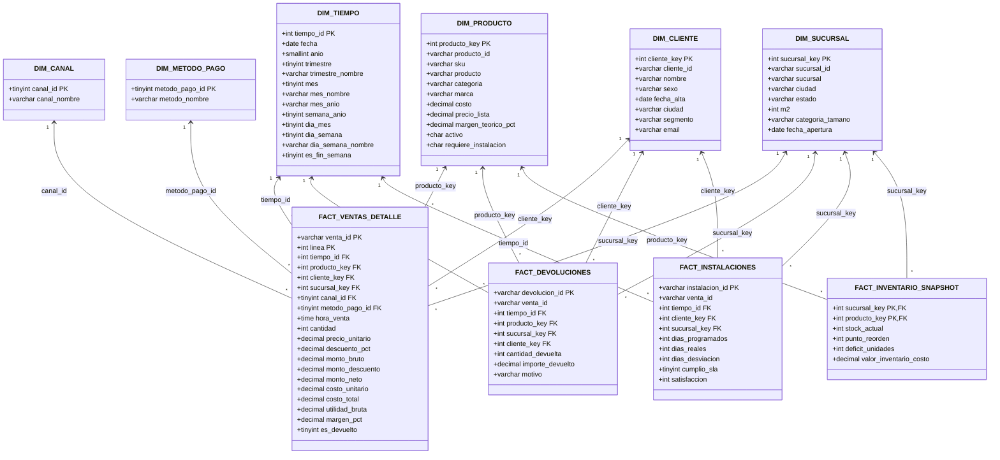

# Esquema Estrella Analítico (Data Mart) — Casa&Estilo
## Modelo Dimensional para Analítica de Negocio (MySQL 8.0 & Power Pivot)

---

### Metadatos
- **Materia:** Analítica e Inteligencia de Negocios
- **Institución:** FIME — UANL
- **Equipo:** Equipo 8
- **Función General:** Documentar el diseño del modelo dimensional en esquema estrella (constelación de hechos) implementado en el Data Mart de Casa&Estilo.
- **Función Específica:** Definir las tablas de hechos, dimensiones conformes, atributos de análisis y cardinalidades que alimentan los tableros de control ejecutivos y cálculos en DAX.

---

## 1. Diagrama de la Arquitectura Dimensional (Esquema Estrella)

---

## 2. Descripción de Dimensiones y Métricas Clave

### 2.1. Métricas Hecho Principal: `FACT_VENTAS_DETALLE`
- **Monto Bruto:** Facturación antes de promociones y bonificaciones ($Cantidad \times PrecioUnitario$).
- **Monto Descuento:** Ahorro trasladado al cliente según campañas comerciales.
- **Monto Neto:** Ingreso efectivo de la caja de Casa&Estilo ($MontoBruto - MontoDescuento$).
- **Costo Total (COGS):** Costo histórico de los bienes adquiridos al proveedor ($Cantidad \times CostoUnitario$).
- **Utilidad Bruta:** Margen de contribución comercial generado ($MontoNeto - CostoTotal$).
- **Margen Porcentual:** Rentabilidad porcentual sobre el ingreso neto ($\frac{UtilidadBruta}{MontoNeto} \times 100$).

### 2.2. Métricas de Hechos Secundarios
- **Tasa de Reembolsos por Devolución:** Monto total devuelto contrastado con ventas brutas de la categoría.
- **Índice de Nivel de Servicio (SLA) de Instalación:** Porcentaje de instalaciones completadas en un tiempo $\le$ a los días programados.
- **Varianza Promedio de Retraso:** $\text{Días Reales} - \text{Días Programados}$.
- **Riesgo de Desabasto en Inventario:** Unidades en déficit frente al punto de reorden por tienda.
