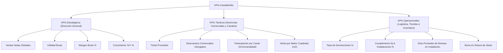

# Catálogo Oficial de Medidas DAX — Casa&Estilo
## Especificación y Formulación de Indicadores en Power Pivot

---

### Metadatos
- **Materia:** Analítica e Inteligencia de Negocios
- **Institución:** FIME — UANL
- **Equipo:** Equipo 8
- **Herramienta:** Microsoft Excel 365 / Power Pivot
- **Función General:** Documentar la formulación matemática y lógica DAX (Data Analysis Expressions) de los KPIs estratégicos, tácticos y operacionales.
- **Función Específica:** Proporcionar la memoria de cálculo para el Tablero Ejecutivo interactivo y permitir su reproducibilidad y auditoría numérica.

---

## 1. Clasificación Jerárquica de KPIs



---

## 2. Catálogo Detallado de Fórmulas DAX

### 2.1. Medida 1: Ventas Brutas
- **Tipo:** Aditiva
- **Nivel:** Estratégico
- **Definición:** Suma total de los subtotales brutos facturados antes de deducir descuentos comerciales.
- **Fórmula DAX:**
```dax
Ventas Brutas := SUM(FactVentasDetalle[monto_bruto])
```
- **Formato:** Moneda `$#,##0.00`
- **Valor Global Registrado:** `$1,402,502,128.39 MXN`

---

### 2.2. Medida 2: Descuentos Comerciales Otorgados
- **Tipo:** Aditiva
- **Nivel:** Táctico
- **Definición:** Importe monetario transferido como descuento promocional a los compradores.
- **Fórmula DAX:**
```dax
Descuentos Totales := SUM(FactVentasDetalle[monto_descuento])
```
- **Formato:** Moneda `$#,##0.00`
- **Valor Global Registrado:** `$91,755,708.99 MXN`

---

### 2.3. Medida 3: Ventas Netas Reales (Ingreso Efectivo)
- **Tipo:** Aditiva
- **Nivel:** Estratégico (Principal)
- **Definición:** Ingreso monetario neto percibido por Casa&Estilo tras restar las bonificaciones y promociones comerciales.
- **Fórmula DAX:**
```dax
Ventas Netas := [Ventas Brutas] - [Descuentos Totales]
```
- **Formato:** Moneda `$#,##0.00`
- **Valor Global Registrado:** `$1,310,746,491.89 MXN`

---

### 2.4. Medida 4: Costo de Mercancía Vendida (COGS)
- **Tipo:** Aditiva
- **Nivel:** Estratégico
- **Definición:** Costo total de adquisición de los productos entregados según el costo estándar del ERP.
- **Fórmula DAX:**
```dax
Costo de Ventas (COGS) := SUM(FactVentasDetalle[costo_total])
```
- **Formato:** Moneda `$#,##0.00`
- **Valor Global Registrado:** `$1,029,871,626.89 MXN`

---

### 2.5. Medida 5: Utilidad Bruta
- **Tipo:** Aditiva
- **Nivel:** Estratégico
- **Definición:** Ganancia comercial bruta resultante de deducir el costo de adquisición de las ventas netas.
- **Fórmula DAX:**
```dax
Utilidad Bruta := [Ventas Netas] - [Costo de Ventas (COGS)]
```
- **Formato:** Moneda `$#,##0.00`
- **Valor Global Registrado:** `$280,874,853.71 MXN`

---

### 2.6. Medida 6: Margen Bruto Porcentual (%)
- **Tipo:** No Aditiva (Ratio)
- **Nivel:** Estratégico
- **Definición:** Proporción porcentual del ingreso neto que se convierte en beneficio bruto comercial.
- **Fórmula DAX:**
```dax
Margen Bruto % := 
DIVIDE(
    [Utilidad Bruta],
    [Ventas Netas],
    0
)
```
- **Formato:** Porcentaje `0.00%`
- **Valor Global Registrado:** `21.43%`

---

### 2.7. Medida 7: Ticket Promedio
- **Tipo:** No Aditiva (Ratio)
- **Nivel:** Táctico
- **Definición:** Gasto monetario promedio por cada transacción o ticket de compra único registrado en el POS.
- **Fórmula DAX:**
```dax
Ticket Promedio := 
DIVIDE(
    [Ventas Netas],
    DISTINCTCOUNT(FactVentasDetalle[venta_id]),
    0
)
```
- **Formato:** Moneda `$#,##0.00`
- **Valor Global Registrado:** `$9,362.47 MXN`

---

### 2.8. Medida 8: Tasa de Devoluciones (%)
- **Tipo:** No Aditiva (Ratio)
- **Nivel:** Operacional / Calidad
- **Definición:** Relación porcentual entre el importe total reembolsado por devoluciones y la venta bruta emitida.
- **Fórmula DAX:**
```dax
Tasa de Devolucion % := 
DIVIDE(
    SUM(FactDevoluciones[importe_devuelto]),
    [Ventas Brutas],
    0
)
```
- **Formato:** Porcentaje `0.00%`
- **Valor Global Registrado:** `1.63%` (Total reembolsado: `$22,897,836.87 MXN`)

---

### 2.9. Medida 9: Nivel de Cumplimiento Logístico (SLA Instalaciones %)
- **Tipo:** No Aditiva (Ratio)
- **Nivel:** Operacional / Servicio al Cliente
- **Definición:** Proporción de servicios técnicos completados dentro de los días pactados con el cliente ($Días Reales \le Días Programados$).
- **Fórmula DAX:**
```dax
Cumplimiento SLA Instalaciones % := 
DIVIDE(
    CALCULATE(COUNTROWS(FactInstalaciones), FactInstalaciones[cumplio_sla] = 1),
    COUNTROWS(FactInstalaciones),
    0
)
```
- **Formato:** Porcentaje `0.00%`
- **Valor Global Registrado:** `34.77%` (Alerta Crítica: 65.23% de servicios fuera de SLA)

---

### 2.10. Medida 10: Crecimiento Interanual (YoY %)
- **Tipo:** Time Intelligence
- **Nivel:** Estratégico
- **Definición:** Tasa de variación porcentual de las ventas netas del periodo actual frente al mismo periodo del año inmediato anterior.
- **Fórmula DAX:**
```dax
Ventas Netas LY := 
CALCULATE(
    [Ventas Netas],
    SAMEPERIODLASTYEAR(DimTiempo[fecha])
)

Crecimiento YoY % := 
DIVIDE(
    [Ventas Netas] - [Ventas Netas LY],
    [Ventas Netas LY],
    0
)
```
- **Formato:** Porcentaje `+0.00%;-0.00%;0.00%`
