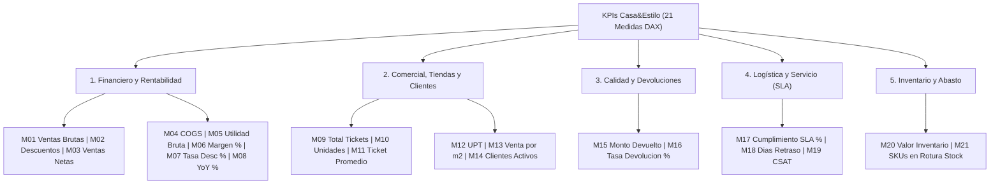

# Catálogo Oficial de Medidas DAX — Casa&Estilo (21 KPIs / 5 Pilares)
## Especificación y Formulación de Indicadores en Power Pivot (Modelo Constelación)

---

### Metadatos
- **Materia:** Analítica e Inteligencia de Negocios
- **Institución:** FIME — UANL
- **Equipo:** Equipo 8
- **Herramienta:** Microsoft Excel 365 / Power Pivot (VertiPaq)
- **Versión:** v2.0 (Ampliación integral a 5 Pilares de Negocio y 21 Medidas DAX)
- **Función General:** Documentar la formulación matemática y lógica DAX (Data Analysis Expressions) de los 21 KPIs estratégicos, tácticos y operacionales de Casa&Estilo.
- **Función Específica:** Servir como diccionario copiable para la implementación en Power Pivot (`TablaFactVentas`, `TablaFactDevoluciones`, `TablaFactInstalaciones`, `TablaFactInventario` y 6 dimensiones conformes) y permitir la auditoría 100% exacta contra MySQL 8.0 (`ce_bi`).

---

## 1. Arquitectura de KPIs por Pilar de Negocio



---

## 2. Tablas del Modelo de Datos (Nombres de Tablas en Excel / Power Query)

Todas las fórmulas DAX de este catálogo utilizan los nombres exactos de las `ListObjects` incluidas en el libro de trabajo (`TablaFact*` / `TablaDim*`):

| Tabla en Power Pivot | Tipo | Filas | Clave Primaria / Llaves Foráneas |
| :--- | :---: | :---: | :--- |
| `TablaFactVentas` | Hecho (Atómico) | `331,758` | `venta_id`, `tiempo_id`, `producto_key`, `cliente_key`, `sucursal_key`, `canal_id`, `metodo_pago_id` |
| `TablaFactDevoluciones` | Hecho (Calidad) | `9,952` | `devolucion_id`, `tiempo_id`, `producto_key`, `sucursal_key`, `cliente_key` |
| `TablaFactInstalaciones` | Hecho (Logística) | `6,500` | `instalacion_id`, `tiempo_id`, `sucursal_key`, `cliente_key` |
| `TablaFactInventario` | Hecho (Snapshot) | `21,440` | `sucursal_key`, `producto_key` |
| `TablaDimTiempo` | Dimensión | `1,096` | `tiempo_id` (PK) / `fecha` (2024-01-01 a 2026-12-31) |
| `TablaDimProducto` | Dimensión | `1,341` | `producto_key` (PK) |
| `TablaDimSucursal` | Dimensión | `17` | `sucursal_key` (PK) |
| `TablaDimCanal` | Dimensión | `3` | `canal_id` (PK) |
| `TablaDimCliente` | Dimensión | `10,801` | `cliente_key` (PK) |
| `TablaDimMetodoPago` | Dimensión | `4` | `metodo_pago_id` (PK) |

---

## 3. Catálogo Detallado de las 21 Medidas DAX

### Pilar 1: Financiero y Rentabilidad

#### M01. Ventas Brutas
- **Nivel / Tipo:** Estratégico / Aditiva
- **Tabla sugerida en Power Pivot:** `TablaFactVentas`
```dax
Ventas Brutas := SUM(TablaFactVentas[monto_bruto])
```
- **Formato:** `$#,##0.00` · **Valor Certificado:** `$1,402,502,128.39`

#### M02. Descuentos Totales
- **Nivel / Tipo:** Táctico / Aditiva
- **Tabla sugerida:** `TablaFactVentas`
```dax
Descuentos Totales := SUM(TablaFactVentas[monto_descuento])
```
- **Formato:** `$#,##0.00` · **Valor Certificado:** `$91,755,708.99`

#### M03. Ventas Netas
- **Nivel / Tipo:** Estratégico / Derivada
- **Tabla sugerida:** `TablaFactVentas`
```dax
Ventas Netas := [Ventas Brutas] - [Descuentos Totales]
```
- **Formato:** `$#,##0.00` · **Valor Certificado:** `$1,310,746,491.89`

#### M04. Costo de Ventas (COGS)
- **Nivel / Tipo:** Estratégico / Aditiva
- **Tabla sugerida:** `TablaFactVentas`
```dax
Costo de Ventas (COGS) := SUM(TablaFactVentas[costo_total])
```
- **Formato:** `$#,##0.00` · **Valor Certificado:** `$1,029,871,626.89`

#### M05. Utilidad Bruta
- **Nivel / Tipo:** Estratégico / Derivada
- **Tabla sugerida:** `TablaFactVentas`
```dax
Utilidad Bruta := [Ventas Netas] - [Costo de Ventas (COGS)]
```
- **Formato:** `$#,##0.00` · **Valor Certificado:** `$280,874,853.71`

#### M06. Margen Bruto %
- **Nivel / Tipo:** Estratégico / Ratio
- **Tabla sugerida:** `TablaFactVentas`
```dax
Margen Bruto % := DIVIDE([Utilidad Bruta], [Ventas Netas], 0)
```
- **Formato:** `0.00%` · **Valor Certificado:** `21.43%`

#### M07. Tasa de Descuento %
- **Nivel / Tipo:** Táctico / Ratio
- **Tabla sugerida:** `TablaFactVentas`
```dax
Tasa de Descuento % := DIVIDE([Descuentos Totales], [Ventas Brutas], 0)
```
- **Formato:** `0.00%` · **Valor Certificado:** `6.54%`

#### M08. Crecimiento YoY %
- **Nivel / Tipo:** Estratégico / Time Intelligence
- **Requisito:** Marcar `TablaDimTiempo` como **Tabla de Fechas** usando la columna `[fecha]` (Power Pivot $\to$ *Diseño* $\to$ *Marcar como tabla de fechas*).
- **Tabla sugerida:** `TablaFactVentas`
```dax
Ventas Netas LY := CALCULATE([Ventas Netas], SAMEPERIODLASTYEAR(TablaDimTiempo[fecha]))

Crecimiento YoY % :=
DIVIDE(
    [Ventas Netas] - [Ventas Netas LY],
    [Ventas Netas LY],
    0
)
```
- **Formato:** `+0.00%;-0.00%;0.00%` · **Valor Certificado (2025 vs 2024):** `+0.86%` (`$479.81M` vs `$475.74M`)

---

### Pilar 2: Comercial, Sucursales, Canales y Clientes

#### M09. Total Tickets
- **Nivel / Tipo:** Táctico / Distintivo (`DISTINCTCOUNT`)
- **Tabla sugerida:** `TablaFactVentas`
```dax
Total Tickets := DISTINCTCOUNT(TablaFactVentas[venta_id])
```
- **Formato:** `#,##0` · **Valor Certificado:** `140,000`

#### M10. Unidades Vendidas
- **Nivel / Tipo:** Táctico / Aditiva
- **Tabla sugerida:** `TablaFactVentas`
```dax
Unidades Vendidas := SUM(TablaFactVentas[cantidad])
```
- **Formato:** `#,##0` · **Valor Certificado:** `831,382`

#### M11. Ticket Promedio
- **Nivel / Tipo:** Táctico / Ratio
- **Tabla sugerida:** `TablaFactVentas`
```dax
Ticket Promedio := DIVIDE([Ventas Netas], [Total Tickets], 0)
```
- **Formato:** `$#,##0.00` · **Valor Certificado:** `$9,362.47`

#### M12. Unidades por Ticket (UPT)
- **Nivel / Tipo:** Táctico / Ratio
- **Tabla sugerida:** `TablaFactVentas`
```dax
Unidades por Ticket (UPT) := DIVIDE([Unidades Vendidas], [Total Tickets], 0)
```
- **Formato:** `0.00` · **Valor Certificado:** `5.94`

#### M13. Venta por m2
- **Nivel / Tipo:** Táctico / Productividad Espacial
- **Tabla sugerida:** `TablaFactVentas`
```dax
Venta por m2 := DIVIDE([Ventas Netas], SUM(TablaDimSucursal[m2]), 0)
```
- **Formato:** `$#,##0.00` · **Valor Global Certificado:** `$58,226.93 / m²` (sobre `22,511 m²` totales; varía por sucursal).

#### M14. Clientes Activos
- **Nivel / Tipo:** Táctico / CRM (`DISTINCTCOUNT`)
- **Tabla sugerida:** `TablaFactVentas`
```dax
Clientes Activos := DISTINCTCOUNT(TablaFactVentas[cliente_key])
```
- **Formato:** `#,##0` · **Valor Certificado:** `10,800` compradores distintos (`4,870` Frecuentes, `2,715` Nuevos, `2,001` Inactivos, `1,214` Premium)

---

### Pilar 3: Calidad y Devoluciones

#### M15. Monto Devuelto
- **Nivel / Tipo:** Operacional / Aditiva
- **Tabla sugerida:** `TablaFactDevoluciones`
```dax
Monto Devuelto := SUM(TablaFactDevoluciones[importe_devuelto])
```
- **Formato:** `$#,##0.00` · **Valor Certificado:** `$22,897,836.87` (`9,952` eventos / `13,712` piezas)

#### M16. Tasa de Devolucion %
- **Nivel / Tipo:** Operacional / Ratio (Constelación Ventas $\leftrightarrow$ Devoluciones vía Dimensiones Conformes)
- **Tabla sugerida:** `TablaFactDevoluciones`
```dax
Tasa de Devolucion % := DIVIDE([Monto Devuelto], [Ventas Brutas], 0)
```
- **Formato:** `0.00%` · **Valor Certificado:** `1.63%`

---

### Pilar 4: Logística y Servicio (SLA de Instalaciones)

#### M17. Cumplimiento SLA %
- **Nivel / Tipo:** Operacional / Ratio (Contexto Filtrado `CALCULATE`)
- **Tabla sugerida:** `TablaFactInstalaciones`
```dax
Cumplimiento SLA % :=
DIVIDE(
    CALCULATE(COUNTROWS(TablaFactInstalaciones), TablaFactInstalaciones[cumplio_sla] = 1),
    COUNTROWS(TablaFactInstalaciones),
    0
)
```
- **Formato:** `0.00%` · **Valor Certificado:** `36.91%` (`2,399` cumplidos de `6,500` servicios — **Alerta Crítica**)

#### M18. Dias Promedio Retraso
- **Nivel / Tipo:** Operacional / Promedio (`days_reales - days_programados`)
- **Tabla sugerida:** `TablaFactInstalaciones`
```dax
Dias Promedio Retraso := AVERAGE(TablaFactInstalaciones[dias_desviacion])
```
- **Formato:** `+0.00;-0.00;0.00` · **Valor Certificado:** `+3.41 días` (`10.93` reales vs `7.52` pactados)

#### M19. Satisfaccion CSAT
- **Nivel / Tipo:** Operacional / Experiencia del Cliente
- **Tabla sugerida:** `TablaFactInstalaciones`
```dax
Satisfaccion CSAT := AVERAGE(TablaFactInstalaciones[satisfaccion])
```
- **Formato:** `0.00` · **Valor Certificado:** `2.99 / 5.0` (Desciende a `2.86` en sucursales críticas como Apodaca 2)

---

### Pilar 5: Inventario y Abasto

#### M20. Valor Inventario (Costo)
- **Nivel / Tipo:** Operacional / Semi-Aditiva (Snapshot actual)
- **Tabla sugerida:** `TablaFactInventario`
```dax
Valor Inventario (Costo) := SUM(TablaFactInventario[valor_inventario_costo])
```
- **Formato:** `$#,##0.00` · **Valor Certificado:** `$2,373,716,477.50` (`1,912,915` piezas físicas)

#### M21. SKUs en Rotura Stock
- **Nivel / Tipo:** Operacional / Conteo de Riesgo (`CALCULATE`)
- **Tabla sugerida:** `TablaFactInventario`
```dax
SKUs en Rotura Stock :=
CALCULATE(
    COUNTROWS(TablaFactInventario),
    TablaFactInventario[estatus_stock] = "Rotura Stock"
)
```
- **Formato:** `#,##0` · **Valor Certificado:** `126` combinaciones tienda-SKU con existencia `0` (`2,738` piezas en déficit; adicionalmente existen `2,566` combinaciones en `Alerta Reorden`)
