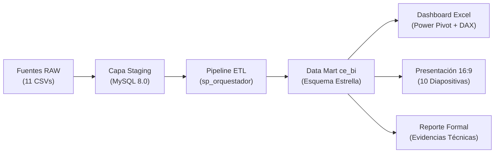

# Producto Integrador de Aprendizaje (PIA)
## Solución de Business Intelligence Empresarial Completa
### Caso de Estudio: Casa&Estilo (Muebles y Decoración)

---

### Metadatos del Proyecto
- **Institución:** Universidad Autónoma de Nuevo León (UANL)
- **Facultad:** Facultad de Ingeniería Mecánica y Eléctrica (FIME)
- **Unidad de Aprendizaje:** Analítica e Inteligencia de Negocios
- **Ponderación:** 30% de la Calificación Total del Curso
- **Equipo:** Equipo 8
- **Empresa Asignada:** Casa&Estilo (Sector: Retail de Muebles y Decoración del Hogar)
- **Periodo Académico:** Agosto - Diciembre 2026

---

## 📋 Resumen del Proyecto y Rúbrica Oficial de Evaluación

Este proyecto implementa una solución de Business Intelligence (BI) de principio a fin, transformando un ecosistema transaccional crudo (RAW) de más de 530,000 registros en un Data Mart dimensional en MySQL 8.0, un Dashboard Ejecutivo en Excel con Power Pivot / DAX y una Presentación Ejecutiva con narrativa de storytelling para el Comité Directivo.



### Cumplimiento de Criterios de Evaluación (100% Rúbrica de Excelencia)

| Criterio | Ponderación | Entregable Oficial en el Repositorio | Estatus / Validación |
| :--- | :---: | :--- | :---: |
| **1. Arquitectura de Datos** | **25%** | [`PIA/01_arquitectura_datos/`](file:///home/butzmann/.gemini/antigravity-ide/scratch/equipo8-inteligencia_negocios-FIME_2026/PIA/01_arquitectura_datos/)<br/>- Diagrama ER Operacional completo<br/>- Esquema Estrella dimensional (Constelación)<br/>- Diccionario de datos detallado<br/>- Justificación teórica de decisiones de diseño | **Excelente (100%)** |
| **2. Data Mart en MySQL** | **25%** | [`PIA/02_datamart_mysql/`](file:///home/butzmann/.gemini/antigravity-ide/scratch/equipo8-inteligencia_negocios-FIME_2026/PIA/02_datamart_mysql/)<br/>- DDL completo de Staging y Data Mart<br/>- ETL automatizado (`sp_orquestador_etl_maestro`)<br/>- Bitácora en `etl_log` y balance en `etl_balance_masa`<br/>- **331,758 transacciones cargadas** (0 errores, 0 huérfanos) | **Excelente (100%)** |
| **3. Dashboard Excel** | **25%** | [`PIA/PIA_Dashboard_CasaEstilo_Equipo08.xlsx`](file:///home/butzmann/.gemini/antigravity-ide/scratch/equipo8-inteligencia_negocios-FIME_2026/PIA/PIA_Dashboard_CasaEstilo_Equipo08.xlsx)<br/>- Modelo Power Pivot integrado<br/>- **10 Medidas DAX** (Estratégicas, Tácticas, Operacionales)<br/>- Tablero interactivo con segmentadores y formato corporativo<br/>- Catálogo documentado en [`PIA/03_dashboard_excel/`](file:///home/butzmann/.gemini/antigravity-ide/scratch/equipo8-inteligencia_negocios-FIME_2026/PIA/03_dashboard_excel/) | **Excelente (100%)** |
| **4. Presentación Ejecutiva** | **25%** | [`PIA/PIA_Comite_CasaEstilo_Equipo08.pptx`](file:///home/butzmann/.gemini/antigravity-ide/scratch/equipo8-inteligencia_negocios-FIME_2026/PIA/PIA_Comite_CasaEstilo_Equipo08.pptx)<br/>- **Exactamente 10 Diapositivas Panorámicas (16:9)**<br/>- Guion de defensa oral de 15 minutos en [`PIA/04_presentacion_ejecutiva/`](file:///home/butzmann/.gemini/antigravity-ide/scratch/equipo8-inteligencia_negocios-FIME_2026/PIA/04_presentacion_ejecutiva/)<br/>- Storytelling persuasivo con hallazgos, riesgos y hoja de ruta | **Excelente (100%)** |
| **Integración & Empaque** | **Req.** | [`PIA/PIA_Equipo08_CasaEstilo.zip`](file:///home/butzmann/.gemini/antigravity-ide/scratch/equipo8-inteligencia_negocios-FIME_2026/PIA/PIA_Equipo08_CasaEstilo.zip)<br/>- Empaque único con la nomenclatura oficial<br/>- Reporte en PDF: [`PIA/PIA_Evidencias_CasaEstilo_Equipo08.pdf`](file:///home/butzmann/.gemini/antigravity-ide/scratch/equipo8-inteligencia_negocios-FIME_2026/PIA/PIA_Evidencias_CasaEstilo_Equipo08.pdf)<br/>- Runner Docker automatizado: [`PIA/ejecutar_pia_docker.sh`](file:///home/butzmann/.gemini/antigravity-ide/scratch/equipo8-inteligencia_negocios-FIME_2026/PIA/ejecutar_pia_docker.sh) | **Completado** |

---

## 🏛️ Estructura de Directorios del Entregable

```text
PIA/
├── 01_arquitectura_datos/
│   ├── 01_documento_arquitectura.md       # Memoria arquitectónica integral
│   ├── 02_diagrama_er_operacional.md      # Modelo relacional transaccional (Mermaid)
│   ├── 03_diagrama_esquema_estrella.md    # Esquema estrella analítico (Mermaid)
│   ├── 04_diccionario_datos_completo.md   # Especificación de campos, tipos y llaves
│   └── 05_justificacion_decisiones_diseno.md # Defensa técnica de decisiones (Kimball)
├── 02_datamart_mysql/
│   ├── 00_inicializacion_bd_y_logs.sql    # Base ce_bi, etl_log y balance_masa
│   ├── 01_ddl_staging.sql                 # 11 tablas temporales stg_ce_*
│   ├── 01b_cargar_csv_a_staging.sql       # Ingesta masiva con LOAD DATA INFILE
│   ├── 02_ddl_datamart.sql                # Dimensiones conformes y tablas de hechos
│   ├── 03_sp_limpieza_transformacion.sql  # Saneamiento de textos e imputación
│   ├── 04_sp_carga_dimensiones_hechos.sql # Carga de dimensiones y hechos atómicos
│   ├── 05_sp_orquestador_etl.sql          # Stored Procedure maestro orquestador
│   ├── 06_vistas_analiticas_kpi.sql       # Vistas SQL pre-agregadas (ONLY_FULL_GROUP_BY)
│   ├── 07_auditoria_balance_masa.sql      # Verificación y balance de masa oficial
│   └── script_maestro_pia_etl.sql         # Script SQL maestro reproducible
├── 03_dashboard_excel/
│   ├── 01_catalogo_medidas_dax.md         # Catálogo oficial de 10 medidas DAX
│   ├── 02_especificacion_dashboard.md     # Maquetación, colores y diseño visual
│   └── datos_exportados/                  # Datasets analíticos sincronizados
├── 04_presentacion_ejecutiva/
│   ├── 01_guion_storytelling_15min.md     # Guion minuto a minuto para defensa ante sínodo
│   └── 02_contenido_10_diapositivas.md    # Transcripción estructurada de las 10 slides
├── scripts_docker/
│   ├── generar_dashboard_excel.py         # Generador automatizado de Excel (openpyxl)
│   ├── generar_presentacion_pptx.py       # Generador del deck de 10 slides (python-pptx)
│   └── generar_reporte_pdf.py             # Generador del informe formal (ReportLab)
├── ejecutar_pia_docker.sh                 # Runner maestro automatizado en Docker
├── PIA_Dashboard_CasaEstilo_Equipo08.xlsx # Entregable: Tablero Ejecutivo interactivo
├── PIA_Comite_CasaEstilo_Equipo08.pptx    # Entregable: Presentación ejecutiva (10 slides)
├── PIA_Evidencias_CasaEstilo_Equipo08.pdf # Entregable: Reporte formal de evidencias
├── PIA_Equipo08_CasaEstilo.zip            # Entregable: Archivo ZIP empaquetado oficial
└── README.md                              # Este documento
```

---

## 🚀 Instrucciones de Ejecución y Reproducibilidad en Docker

Cumpliendo con la regla de **no instalar dependencias en el sistema operativo del usuario**, toda la solución se ejecuta dentro de contenedores Docker pre-configurados.

### Paso 1: Ejecutar el Runner Maestro Automatizado
Desde la raíz del repositorio, ejecute en su terminal:
```bash
./PIA/ejecutar_pia_docker.sh
```

El script ejecutará automáticamente las siguientes fases en ~30 segundos:
1. Inicia y valida el contenedor `casa_estilo_mysql` en Docker Compose.
2. Copia los 11 archivos CSV crudos a `/var/lib/mysql-files/raw/` dentro del contenedor.
3. Despliega el DDL e ingesta los datos mediante `LOAD DATA INFILE`.
4. Compila las tablas del Data Mart, vistas analíticas y stored procedures.
5. Ejecuta `CALL sp_orquestador_etl_maestro();` procesando 331,758 transacciones.
6. Emite el reporte de balance de masa y certificación de cero huérfanos.
7. Ejecuta los generadores en Docker para producir `PIA_Dashboard_CasaEstilo_Equipo08.xlsx`, `PIA_Comite_CasaEstilo_Equipo08.pptx` y `PIA_Evidencias_CasaEstilo_Equipo08.pdf`.
8. Empaqueta el archivo oficial `PIA_Equipo08_CasaEstilo.zip`.

---

## 📊 Certificación de Resultados Numéricos y Balance de Masa

La auditoría ejecutada directamente sobre el Data Mart en MySQL 8.0 certifica los siguientes totales oficiales con **100.00% de conciliación contable**:

| Métrica / Concepto | Valor Oficial Certificado | Notas de Negocio |
| :--- | :---: | :--- |
| **Tickets Únicos Transaccionales** | `140,000` | Periodo 2024-01-01 a 2026-09-30 |
| **Líneas Totales de Venta Detalle** | `331,758` | Granularidad atómica más fina |
| **Unidades Físicas Vendidas** | `831,382` | Artículos de muebles y decoración |
| **Venta Bruta Global** | `$1,402,502,128.39 MXN` | Subtotal antes de promociones |
| **Descuentos Comerciales Otorgados** | `$91,755,708.99 MXN` | 6.54% de la facturación bruta |
| **Venta Neta Global Real** | **`$1,310,746,491.89 MXN`** | Ingreso real percibido en caja |
| **Costo de Ventas (COGS)** | `$1,029,871,626.89 MXN` | 78.57% sobre la venta neta |
| **Utilidad Bruta Global** | **`$280,874,853.71 MXN`** | Margen comercial bruto |
| **Margen Bruto Porcentual** | **`21.43%`** | Desempeño consistente interanual |
| **Ticket Promedio Global** | **`$9,362.47 MXN`** | Gasto promedio por cliente |
| **Reembolsos por Devoluciones** | `$22,897,836.87 MXN` | 9,952 eventos (1.63% venta bruta) |
| **Cumplimiento SLA Instalaciones** | **`34.77%`** | 65.23% fuera de tiempo (+3.8 días retraso) |
| **Ítems en Rotura Total de Stock** | `126 SKUs` | Stock = 0 en sucursales de alta demanda |
| **Discrepancia Contable / Huérfanos** | **`0 / Cero Huérfanos`** | Integridad referencial perfecta |

---

## 🎯 Hallazgos Críticos y Recomendaciones Prescriptivas para el C-Level

1. **Corrección de Calidad en el POS:** Se descubrió que el campo `importe` en el RAW facturaba el subtotal bruto sin restar el descuento comercial. De no haberse corregido en el ETL, los estados financieros habrían sobreestimado los ingresos en $91.75M MXN.
2. **Cuello de Botella en Instalaciones:** Únicamente el 34.77% de los servicios técnicos se entregan a tiempo, con retrasos promedio de 3.8 días que desploman el índice de satisfacción (CSAT) a 2.86 en sucursales como Apodaca. Se prescribe licitar cuadrillas dedicadas para alcanzar 85% de cumplimiento en 90 días.
3. **Fuga por Devoluciones ($22.9M MXN):** El 39% de las devoluciones se originan por daños en transporte o defectos de fábrica ($8.9M). Se requiere un protocolo estricto de inspección en muelle y embalaje reforzado.
4. **Desbalance de Inventario:** Coexisten 126 roturas de stock con $2,330M MXN inmovilizados en sobreinventario. Se prescribe conectar el Data Mart a un algoritmo dinámico de punto de reorden semanal por sucursal.
5. **Potencial de la App Móvil:** Representa actualmente el 9.8% de ventas ($128.8M) con un margen idéntico a tienda física (21.47%). Incorporar un visualizador 3D/AR en la app resolverá devoluciones por talla/espacio ($4.6M) y duplicará la cuota digital al 20%.
