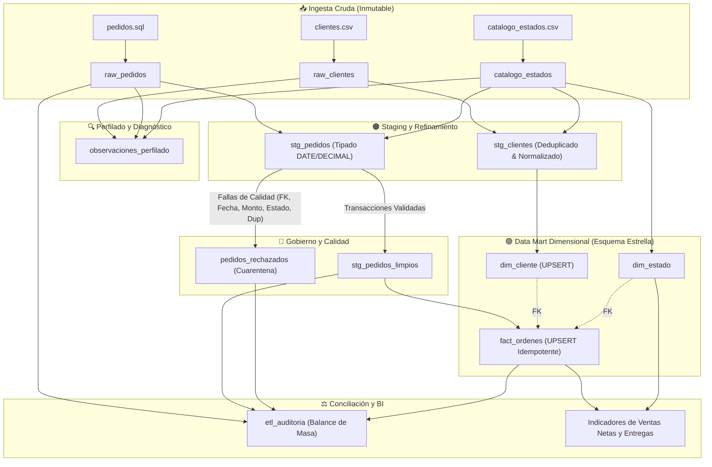

# 🏭 Unidad 4: Laboratorio ETL · Del Archivo Crudo al Data Mart
**Materia:** Inteligencia de Negocios · FIME 2026  
**Motor:** MySQL 8.0+ (Contenerizado en Docker)  
**Equipo:** Equipo 8 (Casa&Estilo)  
**Integrantes:**
- Arely Carrillo Sustaita - 2226630
- Rafael Jesús Collazo Hernández - 2169304
- Sergio Jaziel Butzmann Martinez - 2163239

---

## 🎯 1. Propósito y Escenario del Laboratorio
Una plataforma de comercio electrónico recibe periódicamente archivos desestructurados o transaccionales con inconsistencias intencionales: `clientes.csv`, `pedidos.sql` y `catalogo_estados.csv`. El objetivo es construir un pipeline ETL determinista, robusto y reproducible en MySQL 8.0 para poblar un Data Mart analítico de ventas por estado y fecha, con trazabilidad integral de rechazos (cuarentena), control de idempotencia mediante UPSERT y auditoría de balance de masa.

> [!IMPORTANT]
> **Regla de Inmutabilidad:** Los archivos y tablas crudas (`raw_*`) jamás deben ser modificados manualmente ni sobrescritos destructivamente. Todas las correcciones de calidad deben realizarse de forma transparente y automatizada en la capa de transformación (`stg_*`) y mesa de rechazos (`pedidos_rechazados`).

---

## 🏗️ 2. Arquitectura de Datos por Capas



---

## 📂 3. Estructura Modular de Entregables

```text
unidad_4/
├── 01_datos_crudos/
│   ├── 01_creacion_bd.sql                 # DDL de base de datos 'tienda_bi' y tablas raw_*
│   ├── 02_carga_datos_iniciales.sql       # Población automatizada de catalogo y clientes
│   ├── catalogo_estados.csv               # Catálogo oficial con claves canónicas y alias
│   ├── clientes.csv                       # Clientes con formatos heterogéneos y anomalías
│   └── pedidos.sql                        # 32 órdenes crudas con errores deliberados
├── 02_perfilado/
│   ├── 01_perfilado_datos.sql             # Consultas de detección y registro en tabla observaciones
│   └── reporte_perfilado.md               # Bitácora analítica y matriz de riesgos
├── 03_staging_y_normalizacion/
│   ├── 02_staging_y_normalizacion.sql     # Normalización de alias estatales y tipado DATE
│   └── documentacion_staging.md           # Justificación de inmutabilidad y homologación
├── 04_validacion_y_rechazos/
│   ├── 03_validacion_y_rechazos.sql       # Aislamiento en cuarentena y pedidos limpios
│   └── documentacion_rechazos.md          # Diccionario de rechazos y trazabilidad
├── 05_carga_incremental/
│   ├── 04_carga_incremental_upsert.sql   # DDL del Data Mart y UPSERT idempotente
│   └── documentacion_upsert_idempotencia.md # Fundamentación de estabilidad de claves
├── 06_conciliacion_auditoria/
│   ├── 05_conciliacion_auditoria.sql      # Balance de masa y bitácora etl_auditoria
│   └── documentacion_conciliacion.md      # Justificación de discrepancia bruto vs neto
├── 07_indicadores/
│   ├── 06_indicadores_negocio.sql         # Ventas netas y pedidos entregados por estado/fecha
│   └── documentacion_indicadores.md       # Supuestos metodológicos y contables
├── 08_reflexion/
│   └── reflexion_decisiones_limpieza.md   # Respuestas exhaustivas a las preguntas del laboratorio
├── script_maestro_etl.sql                 # Pipeline unificado reproducible de inicio a fin
├── ejecutar_laboratorio_docker.sh         # Script bash para ejecución automatizada en Docker
└── README.md                              # Documentación maestra del laboratorio
```

---

## 🔬 4. Resumen Ejecutivo de Cada Paso

### Paso 1: Perfilado de Datos
Se ejecutó un diagnóstico sistemático sobre las 3 tablas crudas. Los hallazgos se persistieron en `observaciones_perfilado`:
- **Volumetría inicial:** 21 clientes crudos, 32 pedidos crudos, 10 estados canónicos.
- **Anomalías detectadas:** 1 cliente duplicado (`CLI-005`), 2 pedidos con clave repetida (`PED-1001` y `PED-1010`), 2 montos no positivos (uno negativo de `-$350.00` y uno en `$0.00`), 1 cliente inexistente (`CLI-999`), 2 fechas inválidas/vacías y múltiples variantes tipográficas en nombres de estados y formatos temporales (`DD/MM/AAAA`).

### Paso 2 y 3: Staging y Normalización
- **Inmutabilidad:** `raw_*` se conservó intacta como zona de aterrizaje forense.
- **Deduplicación:** `stg_clientes` deduplicó a los clientes utilizando `ROW_NUMBER() OVER (PARTITION BY id_cliente ORDER BY fila_id DESC)`, conservando la versión más reciente (quedando 20 clientes únicos).
- **Homologación de Estados:** Se utilizó `catalogo_estados` para mapear variantes como `'N.L.'`, `'Nuevo Leon'`, `'D.F.'`, `'Jal.'`, `'TAMPS'` a claves canónicas oficiales (`NL`, `CDMX`, `JAL`, `TAM`, etc.). Aquellos clientes sin estado recibieron el valor centinela `'NE'` (*No Especificado*).
- **Tipado de Fechas:** Se procesaron formatos ISO (`YYYY-MM-DD`) y tradicionales (`DD/MM/AAAA`) mediante expresiones regulares deterministas y la función `STR_TO_DATE`.

### Paso 4: Validación y Mesa de Rechazos
Se implementó la tabla `pedidos_rechazados` (Cuarentena). De las 32 órdenes crudas:
- **8 transacciones fueron rechazadas:**
  - `ID_PEDIDO_DUPLICADO` (2): `PED-1001`, `PED-1010` (segunda aparición).
  - `CLIENTE_INEXISTENTE` (1): `PED-1023` (apuntaba a `CLI-999`).
  - `FECHA_INVALIDA` (2): `PED-1024` (fecha vacía), `PED-1025` (cadena `FECHA_ROTA`).
  - `IMPORTE_NO_POSITIVO` (2): `PED-1021` (`-$350.00`), `PED-1022` (`$0.00`).
  - `ESTADO_NO_RECONOCIDO` (1): `PED-1026` (`ESTADO_INEXISTENTE`).
- **24 transacciones fueron aprobadas** e insertadas en `stg_pedidos_limpios`.

### Paso 5: Carga Incremental al Data Mart e Idempotencia
Se crearon las tablas del Data Mart dimensional (`dim_estado`, `dim_cliente`, `fact_ordenes`) y se realizó la carga mediante `INSERT ... ON DUPLICATE KEY UPDATE` (UPSERT) por clave primaria natural.
- **Prueba de Doble Corrida:** Se ejecutó el pipeline completo de carga dos veces consecutivas sin añadir filas al origen:
  - Corrida 1: 24 hechos cargados, monto total de \$39,210.50.
  - Corrida 2: 24 hechos resultantes, monto total de \$39,210.50.
  - **Resultado:** Idempotencia verificada al 100% ($\Delta = 0$).

### Paso 6: Conciliación Cuantitativa y Balance de Masa
Se persistieron las métricas de cuadratura en `etl_auditoria`:
- **Balance Cuantitativo:**
  $$\text{Raw Pedidos (32)} = \text{Staging Limpio (24)} + \text{Rechazados (8)}$$
  $$\text{Discrepancia} = 32 - (24 + 8) = 0 \quad (\text{Balance Cuadrado: SI})$$
- **Balance Monetario:**
  - Importe Bruto en Raw: \$47,840.50.
  - Importe Descartado en Cuarentena: \$8,630.00.
  - Importe Válido en Staging: \$39,210.50.
  - Importe Cargado en `fact_ordenes`: \$39,210.50.
  - Desvío Financiero Staging vs Hechos: **\$0.00**.

### Paso 7: Indicadores de Negocio
Se generaron las métricas de pedidos entregados y ventas netas agrupadas por estado y fecha:
- De los 24 pedidos válidos, **21 correspondieron a estatus `'Entregado'`** con un total de **\$35,810.50**. (Los 3 restantes corresponden a órdenes operativas activas o canceladas: 1 `'En tránsito'`, 1 `'Pendiente'` y 1 `'Cancelado'`).
- Los tres estados líderes en ventas netas entregadas fueron:
  1. **Yucatán (`YUC`):** \$6,330.00 (3 pedidos, 17.68% de participación).
  2. **Puebla (`PUE`):** \$6,100.00 (3 pedidos, 17.03% de participación).
  3. **Querétaro (`QRO`):** \$4,400.00 (3 pedidos, 12.29% de participación).

---

## 🧠 5. Respuestas a las Preguntas de Reflexión

1. **¿Qué ocurre si un cliente tiene estado vacío? ¿Se rechaza el cliente o se agrupa como no identificado?**
   - **Decisión:** Se agrupa como no identificado bajo la clave canónica `'NE'` (*No Especificado*).
   - **Justificación:** Rechazar al cliente en la ingesta provocaría la pérdida de su cuenta en la dimensión; si este cliente posteriormente compra en el sitio, todas sus órdenes de compra futuras fallarían por cliente inexistente (huérfano). Asignar `'NE'` preserva la integridad del embudo comercial y permite al equipo de CRM focalizar campañas de actualización de datos.
2. **¿Cómo detectarías pedidos que llegaron tarde?**
   - Incorporando dos campos temporales adicionales en el sistema transaccional y en la tabla de hechos: `fecha_prometida_entrega DATE` y `fecha_entrega_real DATE`. La condición analítica `DATEDIFF(fecha_entrega_real, fecha_prometida_entrega) > 0` permite clasificar la entrega como tardía y calcular el indicador de cumplimiento de SLA (**OTIF - On-Time In-Full**).
3. **¿Cómo modificarías el proceso para admitir devoluciones?**
   - Ingestar un archivo complementario `devoluciones.csv` con validación de que cada devolución apunte a un `id_pedido` previamente entregado. En el Data Mart, la mejor práctica arquitectónica es añadir una tabla de hechos separada `fact_devoluciones` vinculada a una dimensión de motivos (`dim_motivo_devolucion`), permitiendo registrar el evento contable en la fecha exacta del reembolso y calcular las **Ventas Netas Reales** como $\sum \text{Ventas Entregadas} - \sum \text{Monto Devoluciones}$.

---

## 🚀 6. Guía Rápida de Ejecución

### Opción 1: Ejecución Total Automatizada en Docker (Recomendada)
El script resuelve dinámicamente las rutas absolutas y la raíz del proyecto, por lo que puede ejecutarse tanto desde la raíz del repositorio como directamente dentro de la carpeta `unidad_4`:

```bash
# Opción A: Desde la raíz del repositorio
./unidad_4/ejecutar_laboratorio_docker.sh

# Opción B: Desde el interior de la carpeta unidad_4
cd unidad_4
./ejecutar_laboratorio_docker.sh
```

### Opción 2: Ejecución del Script Maestro en MySQL Workbench / CLI
Si cuentas con una conexión activa a MySQL Server 8.0:
```bash
mysql -u root -p < unidad_4/script_maestro_etl.sql
```
O abre `unidad_4/script_maestro_etl.sql` dentro de **MySQL Workbench** y presiona el ícono del rayo ⚡ (*Execute SQL Script*).
