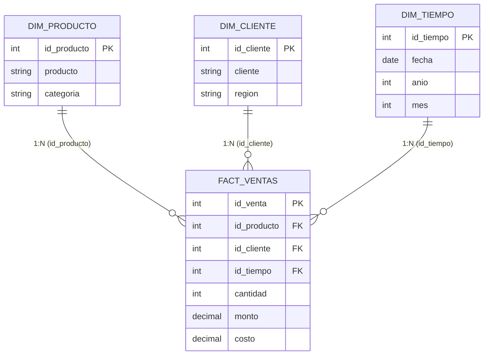

# 🌟 Fase B · Relaciones y Esquema Estrella en Power Pivot

## 🎯 Objetivo de la Fase
Diseñar y configurar el **Esquema Estrella (Star Schema)** en la Vista de Diagrama de Power Pivot (Modelo de Datos de Excel 365), estableciendo relaciones dimensionales de 1 a Varios (1:N) que permitan la propagación natural de filtros analíticos hacia la tabla central de hechos.

---

## 🏛️ Arquitectura del Esquema Estrella

---

## 🔗 Matriz de Relaciones Dimensionales

| Relación | Tabla Origen (Dimensión / Lado 1) | Columna Origen (PK) | Tabla Destino (Hechos / Lado N) | Columna Destino (FK) | Cardinalidad | Dirección del Filtro |
| :--- | :--- | :--- | :--- | :--- | :--- | :--- |
| **Relación 1** | `DIM_PRODUCTO` | `id_producto` | `FACT_VENTAS` | `id_producto` | 1 a Varios (1:N) | Única (Dimensión → Hechos) |
| **Relación 2** | `DIM_CLIENTE` | `id_cliente` | `FACT_VENTAS` | `id_cliente` | 1 a Varios (1:N) | Única (Dimensión → Hechos) |
| **Relación 3** | `DIM_TIEMPO` | `id_tiempo` | `FACT_VENTAS` | `id_tiempo` | 1 a Varios (1:N) | Única (Dimensión → Hechos) |

---

## 🧭 Diagnóstico y Validación de Propagación de Filtros
En Power Pivot, si al construir una tabla dinámica con un campo de dimensión (ej. `DIM_CLIENTE[region]`) y una medida de hechos (ej. `[Ventas]`), se observara que todas las filas muestran la misma cifra total global:
1. **Causa Raíz:** Relación inactiva, mal configurada o dirección de filtro bloqueada.
2. **Solución:**
   - Abrir `Power Pivot` → `Administrar` → `Vista de diagrama`.
   - Confirmar que la línea de relación conecte exactamente las claves `id_cliente` con `id_cliente`.
   - Verificar que el lado "1" esté en la dimensión y el asterisco "*" (Muchos) en `FACT_VENTAS`.
   - Probar la tabla dinámica: `Occidente: $677,408.00`, `Centro: $655,677.00`, `Sur: $608,288.00`, `Norte: $475,003.00`. Al sumar los 4 valores se comprueba que el filtro distribuye exactamente el total de $2,416,376.00.

---

## 📅 Nota Crítica sobre Inteligencia de Tiempo en DAX
El archivo `DIM_TIEMPO.csv` incluye **96 registros específicos** correspondientes a 4 cortes semanales por mes (días 5, 12, 19 y 26 de cada mes) para 2025 y 2026.
- **Limitación Técnica de DAX:** Las funciones nativas de Inteligencia de Tiempo (`SAMEPERIODLASTYEAR`, `DATEADD`, `TOTALYTD`) exigen de forma estricta una tabla de fechas **diaria, continua, sin huecos (gaps) y marcada como Tabla de Fechas**.
- **Consecuencia:** Aplicar `SAMEPERIODLASTYEAR(DIM_TIEMPO[fecha])` sobre este dataset generaría resultados vacíos (`BLANK`) o distorsiones de cálculo.
- **Solución Adoptada:** Para comparaciones interanuales (YoY) y mensuales, se utilizan agrupaciones por `DIM_TIEMPO[anio]` y `DIM_TIEMPO[mes]`, o bien medidas DAX con filtros explícitos sobre el atributo de año.
