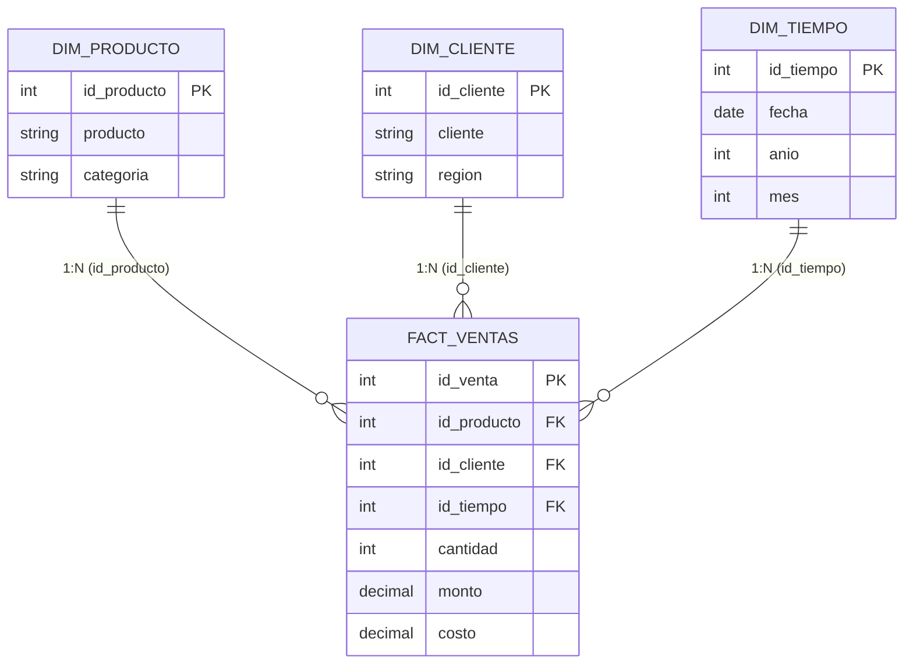

# 📊 Unidad 5 · Del Data Mart al Dashboard Ejecutivo y al Comité Directivo

**Materia:** Inteligencia de Negocios · FIME UANL (2026)  
**Equipo:** Equipo 8  
- **Arely Carrillo Sustaita** - 2226630  
- **Rafael Jesús Collazo Hernández** - 2169304  
- **Sergio Jaziel Butzmann Martinez** - 2163239  

---

## 🎯 Pregunta Rectora y Propósito
> *¿Cómo se comportan las ventas y la rentabilidad por período, región y categoría, y qué decisión justificada con datos podemos recomendar al Comité Directivo?*

El presente laboratorio transforma cuatro archivos transaccionales y catálogos en formato CSV en un **modelo analítico dimensional en esquema estrella** dentro del Modelo de Datos de Excel 365 (Power Pivot). A través de medidas calculadas en lenguaje DAX, validación cuantitativa estricta contra cifras de control (discrepancia $0.00), maquetación de un dashboard gerencial interactivo y la aplicación de los cuatro niveles de análisis de Business Intelligence, el equipo articula una propuesta de decisión empresarial de alto impacto.

---

## 🏛️ Arquitectura del Modelo Dimensional (Esquema Estrella)



---

## 📂 Organización Modular de la Unidad

```text
unidad_5/
├── 01_datos_crudos/                # Cuatro archivos CSV originales e inmutables (1,200 transacciones)
│   ├── FACT_VENTAS.csv
│   ├── DIM_PRODUCTO.csv
│   ├── DIM_CLIENTE.csv
│   ├── DIM_TIEMPO.csv
│   └── README.md
├── 02_calidad_y_powerquery/        # Ingesta, tipado estricto, perfilado y código M
│   ├── perfilado_y_calidad.md
│   ├── scripts_m_powerquery.m
│   └── README.md
├── 03_modelo_estrella_powerpivot/  # Esquema estrella, cardinalidades 1:N y Time Intelligence
│   ├── modelo_dimensional_estrella.md
│   └── README.md
├── 04_medidas_dax/                 # Catálogo de 6 medidas fundamentales + comparativas YoY
│   ├── catalogo_medidas_dax.md
│   ├── formulas_dax.dax
│   └── README.md
├── 05_validacion_numerica/         # Conciliación cuantitativa y matriz de control (Discrepancia $0.00)
│   ├── conciliacion_cifras_control.md
│   └── README.md
├── 06_dashboard_ejecutivo/         # Maquetación, tarjetas KPI, gráficos y segmentadores
│   ├── diseno_y_especificacion_dashboard.md
│   └── README.md
├── 07_analisis_cuatro_niveles/     # Descriptivo, diagnóstico, predictivo y plan prescriptivo
│   ├── analisis_descriptivo_diagnostico_predictivo_prescriptivo.md
│   └── README.md
├── 08_comite_directivo/            # Presentación (7 slides), guion oral 15 min y bitácora IA
│   ├── estructura_narrativa_comite.md
│   ├── guion_exposicion_15min.md
│   ├── bitacora_prompts_ia.md
│   └── README.md
├── scripts_generacion/             # Automatización reproducible en Python
│   ├── validar_datos.py
│   ├── generar_dashboard_excel.py
│   ├── generar_presentacion_pptx.py
│   └── generar_reporte_pdf.py
├── Dockerfile                      # Entorno contenedorizado (Python 3.12-slim)
├── ejecutar_laboratorio_docker.sh  # Runner automatizado maestro 100% reproducible
├── U5_Dashboard_Equipo08.xlsx      # Entregable: Libro Excel con Modelo, DAX y Tablero
├── U5_Comite_Equipo08.pptx         # Entregable: Presentación ejecutiva (7 diapositivas 16:9)
└── U5_Evidencias_Equipo08.pdf      # Entregable: Reporte formal de evidencias académicas
```

---

## ⚖️ Matriz Oficial de Validación contra Cifras de Control

Todas las medidas fueron validadas sin filtros contra los valores de referencia del laboratorio:

| Indicador | Fórmula DAX | Valor Esperado | Valor Calculado | Discrepancia | Estado |
| :--- | :--- | :--- | :--- | :--- | :--- |
| **Transacciones** | `DISTINCTCOUNT(FACT_VENTAS[id_venta])` | `1,200` | `1,200` | `0` | ✅ **Exacto (0.00%)** |
| **Ventas Totales** | `SUM(FACT_VENTAS[monto])` | `MXN $2,416,376.00` | `MXN $2,416,376.00` | `$0.00` | ✅ **Exacto (0.00%)** |
| **Costo Total** | `SUM(FACT_VENTAS[costo])` | `MXN $1,704,180.38` | `MXN $1,704,180.38` | `$0.00` | ✅ **Exacto (0.00%)** |
| **Margen Bruto** | `[Ventas] - [Costo]` | `MXN $712,195.62` | `MXN $712,195.62` | `$0.00` | ✅ **Exacto (0.00%)** |
| **Ticket Promedio** | `DIVIDE([Ventas], [Transacciones], 0)` | `MXN $2,013.65` | `MXN $2,013.65` | `$0.00` | ✅ **Exacto (0.00%)** |
| **Margen %** | `DIVIDE([Margen Bruto], [Ventas], 0)` | `29.47%` | `29.47%` | `0.00%` | ✅ **Exacto (0.00%)** |

---

## 📊 Radiografía de Resultados de Negocio

### 1. Desempeño por Región Geográfica
- **Occidente:** `$677,408.00 MXN` (28.03% del total) | 327 transacciones | Margen: 29.11%
- **Centro:** `$655,677.00 MXN` (27.13% del total) | 324 transacciones | Margen: 29.31%
- **Sur:** `$608,288.00 MXN` (25.17% del total) | 298 transacciones | **Margen más alto: 30.39% ⭐**
- **Norte:** `$475,003.00 MXN` (19.66% del total) | 251 transacciones | **Rezago comercial (-29.9% vs Occidente) ⚠️**

### 2. Desempeño por Categoría de Producto
- **Tecnología:** `$889,916.00 MXN` (36.83%) | Margen: **30.13% ⭐** (Motor de ingresos y margen)
- **Oficina:** `$801,265.00 MXN` (33.16%) | Margen: 28.62%
- **Hogar:** `$725,195.00 MXN` (30.01%) | Margen: 29.61%

### 3. Dinámica Anual y Mensual (YoY)
- **Ventas 2025:** `$1,214,067.00 MXN` (603 transacciones).
- **Ventas 2026:** `$1,202,309.00 MXN` (597 transacciones).
- **Variación Interanual:** `-$11,758.00 MXN` (**-0.97% YoY**), confirmando estabilidad estructural con meseta comercial.

---

## 🧠 Cuatro Niveles de Análisis y Propuesta Estratégica

| Nivel Analítico | Pregunta Clave | Hallazgo y Síntesis Ejecutiva |
| :--- | :--- | :--- |
| **1. Descriptivo** | ¿Qué pasó? | Estabilidad interanual en $1.2M anuales (-0.97%); liderazgo rotundo de Tecnología (36.8% venta y 30.1% margen); polarización territorial donde Centro y Occidente concentran el 55.2% de los ingresos. |
| **2. Diagnóstico** | ¿Dónde se concentró? | Alta rentabilidad porcentual en el Sur (30.4%); rezago en transacciones en el Norte (251 vs 327 en Occidente pese a tener los mismos 20 clientes).<br>• *Hipótesis H1:* Desfase estacional corporativo entre noviembre (-25%) y diciembre (+35%).<br>• *Hipótesis H2:* Fricción logística o menor frecuencia de visita en plazas norteñas. *(Sin asumir falta de stock no medida).* |
| **3. Predictivo** | ¿Qué podría pasar? | Escenario inercial 2027 proyectado en ~$1,195,000 MXN ± $35,000 MXN. De mantenerse la debilidad del Norte (-2.5% anual), el margen bruto sufrirá una erosión gradual por concentración en pocos artículos. |
| **4. Prescriptivo** | ¿Qué conviene hacer? | **Programa de Expansión Norte y Bundles Tecnológicos:**<br>1. Campaña comercial dirigida a los 20 clientes del Norte (+15% ventas objetivo).<br>2. Bundling de Producto 12 (Tecnología) con Producto 11 (Oficina) para elevar el margen de Oficina al 29.5%.<br>3. Responsable: Dirección de Ventas y Logística | Plazo: 6 meses | KPI: Ventas Norte > $275k y Ticket > $2,100 MXN. |

---

## 🐳 Reproducibilidad 100% en Docker (Regla de Oro)

Para cumplir con la regla de oro de **no instalar dependencias en el sistema operativo anfitrión**, el laboratorio cuenta con un ejecutable automatizado que orquesta la validación y generación de entregables dentro de un contenedor Docker:

```bash
# Otorgar permisos de ejecución (si no los tiene)
chmod +x unidad_5/ejecutar_laboratorio_docker.sh

# Ejecutar el pipeline completo de Unidad 5
./unidad_5/ejecutar_laboratorio_docker.sh
```

El script genera y valida automáticamente:
1. `unidad_5/U5_Dashboard_Equipo08.xlsx` (Libro con 6 hojas, medidas, datos y dashboard con 4 gráficos dinámicos).
2. `unidad_5/U5_Comite_Equipo08.pptx` (Presentación ejecutiva de 7 diapositivas 16:9 con notas de orador).
3. `unidad_5/U5_Evidencias_Equipo08.pdf` (Reporte académico formal con numeración de dos pasadas y evidencias A-G).

---

## ⏱️ Verificación y Visualización en Tiempo Real en el Salón de Clases

Para atender la exigencia de **verificación en vivo ante el profesor**, el equipo dispone de tres vías inmediatas:

1. **Vía Excel 365 (Requisito Principal):**
   - Abrir [`U5_Dashboard_Equipo08.xlsx`](file:///home/butzmann/.gemini/antigravity-ide/scratch/equipo8-inteligencia_negocios-FIME_2026/unidad_5/U5_Dashboard_Equipo08.xlsx) en la hoja `Dashboard` y accionar los segmentadores en vivo (Norte, Sur, Tecnología, 2025, 2026).
2. **Vía Web en Tiempo Real (BI Live Studio en Docker):**
   - Ejecutar `./unidad_5/iniciar_dashboard_en_vivo.sh` y abrir [**http://localhost:8085**](http://localhost:8085) en el navegador para interactuar con gráficos reactivos animados (Chart.js), filtros instantáneos y comprobación matemática de $0.00 de discrepancia.
3. **Vía Terminal Proyectable (CLI Runner):**
   - Ejecutar `./unidad_5/verificacion_en_vivo_terminal.sh` para proyectar la auditoría automatizada en tiempo real paso a paso.

Consulte la [**Guía de Verificación en Vivo para el Aula**](file:///home/butzmann/.gemini/antigravity-ide/scratch/equipo8-inteligencia_negocios-FIME_2026/unidad_5/GUIA_VERIFICACION_EN_VIVO_AULA.md) para el protocolo y preguntas frecuentes.
